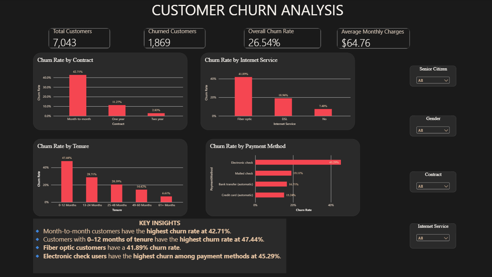
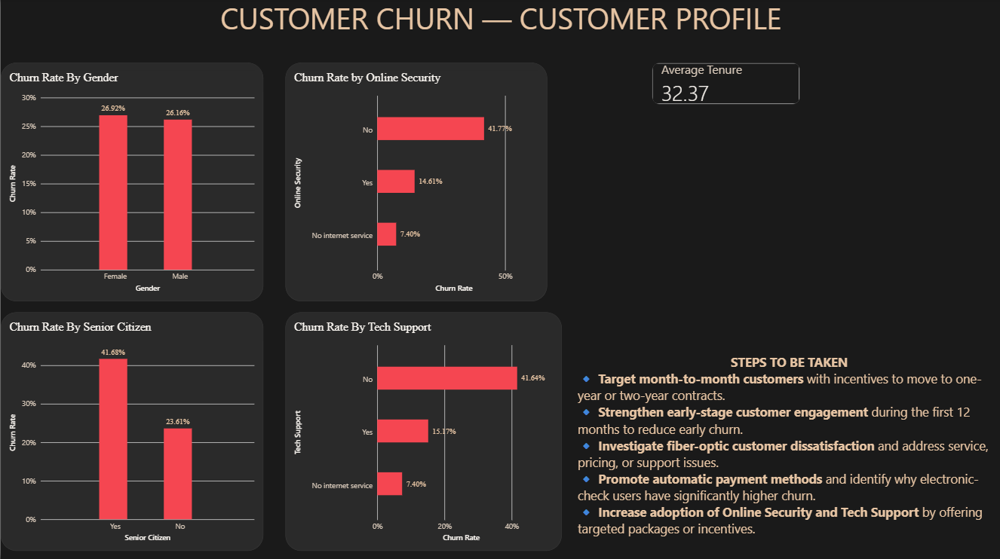

# Customer Churn Analysis

## Overview

This project presents an interactive **Power BI dashboard** for analyzing customer churn and identifying the factors associated with customer attrition.

The dashboard transforms customer data into actionable insights by examining churn across contract type, internet service, tenure, payment method, gender, senior-citizen status, online security, and technical support.

The project follows a complete data analytics workflow:

- Data cleaning and preparation
- Exploratory data analysis
- DAX-based calculations
- Data visualization
- Interactive Power BI dashboard development
- Insight generation
- Business recommendations

---

## Project Objective

The main objective of this project is to understand **why customers churn and which customer characteristics or services are associated with higher churn rates**.

The analysis focuses on:

- Overall customer churn
- Churn by contract type
- Churn by internet service
- Churn by customer tenure
- Churn by payment method
- Churn by gender
- Churn among senior citizens
- Churn by online security
- Churn by technical support
- Average customer tenure
- Identifying actionable strategies to reduce customer churn

---

## Tools & Technologies

- **Power BI** — Dashboard development and visualization
- **DAX** — Measures and KPI calculations
- **Power Query** — Data cleaning and transformation
- **Microsoft Excel / CSV** — Dataset and data storage

---

## Data Preparation

The dataset was cleaned and prepared before building the dashboard.

The preparation process included:

- Cleaning inconsistent values
- Removing unnecessary information
- Standardizing categorical values
- Handling missing or inconsistent data
- Preparing fields for visualization
- Creating calculated measures using DAX
- Structuring the dataset for interactive analysis

---

# Dashboard

The project contains **two interactive Power BI dashboard pages**.

## Page 1 — Customer Churn Overview

The first page provides an executive overview of customer churn.

It includes:

- Total Customers
- Churned Customers
- Overall Churn Rate
- Average Monthly Charges
- Churn Rate by Contract
- Churn Rate by Internet Service
- Churn Rate by Tenure
- Churn Rate by Payment Method
- Interactive slicers
- Key Insights section

## Page 2 — Customer Profile

The second page provides a deeper analysis of customer characteristics associated with churn.

It includes:

- Average Tenure
- Churn Rate by Gender
- Churn Rate by Senior Citizen
- Churn Rate by Online Security
- Churn Rate by Tech Support
- Steps to Be Taken / Business Recommendations

---

## Dashboard Preview

### Page 1 — Customer Churn Overview



### Page 2 — Customer Profile



---

## Key Insights

The analysis identified several important patterns:

- **Month-to-month customers** have the highest churn rate at **42.71%**.
- Customers with **0–12 months of tenure** have the highest churn rate at **47.44%**.
- **Fiber optic customers** have a churn rate of **41.89%**.
- **Electronic check users** have the highest churn among payment methods at **45.29%**.
- **Senior citizens** show a higher churn rate than non-senior customers.
- Customers without **Online Security** show substantially higher churn.
- Customers without **Tech Support** show substantially higher churn.
- Gender shows comparatively little difference in churn compared with factors such as contract type, tenure, and support services.

These findings suggest that customer churn is influenced by a combination of **contract structure, tenure, service type, payment method, and additional support/security services**.

---

## Steps to Be Taken

Based on the patterns identified in the dashboard, the following actions could help reduce customer churn:

- **Target month-to-month customers** with incentives to move toward longer-term contracts.
- **Focus on customers during their first 12 months** through stronger onboarding and early engagement.
- **Investigate fiber-optic customer dissatisfaction** and identify potential service, pricing, or support issues.
- **Encourage automatic payment methods** and investigate the reasons behind higher churn among electronic-check users.
- **Promote Online Security and Tech Support** through targeted packages and incentives.
- Monitor high-risk customer segments and develop retention strategies before customers churn.

These recommendations are based on observed patterns in the dataset and should be validated with additional customer and business data before implementation.

---

## Interactive Features

The dashboard includes synchronized slicers that allow users to explore customer segments interactively.

Available filters include:

- Contract
- Gender
- Senior Citizen
- Internet Service

The slicers can be used to filter the dashboard and explore how churn patterns change across different customer segments.

---

## Dashboard Design

The dashboard uses a consistent dark-themed visual design to create a professional and focused analytical experience.

### Color Palette

- **Background:** Dark Charcoal
- **Chart Cards:** Charcoal Gray
- **Primary Accent:** Red
- **Title & Highlight Text:** Warm Beige
- **Supporting Text:** Light Beige
- **KPI Values:** Light Gray / White

The same visual theme is maintained across both dashboard pages for consistency.

---

## Project Outcomes

This project demonstrates the complete data analytics workflow:

**Data Cleaning → Data Transformation → DAX → Visualization → Dashboard → Insights → Business Recommendations**

The project provided practical experience in:

- Data preparation
- Power Query
- DAX
- KPI development
- Data visualization
- Dashboard design
- Interactive filtering
- Data storytelling
- Business-oriented analysis

The final dashboard transforms raw customer data into an interactive analytical tool that helps identify **high-risk customer segments and potential churn-reduction strategies**.

It also demonstrates how data visualization can be used to move from identifying customer churn patterns to developing practical business actions.

---

## Limitations

- The analysis is based on the available customer dataset.
- Observed relationships do not necessarily imply causation.
- Churn patterns may vary across different businesses, markets, and customer populations.
- Additional factors such as customer satisfaction, competitor pricing, service quality, and customer-support interactions may provide further context.
- Business recommendations should be validated against additional operational and customer-level data.

---

## Future Improvements

Potential improvements include:

- Building a **customer churn prediction model** using machine learning.
- Creating a customer-level **churn risk score**.
- Adding customer satisfaction and support-ticket data.
- Performing statistical tests to evaluate the strength of observed relationships.
- Adding drill-through pages for detailed customer segmentation.
- Incorporating time-based churn trends if historical data becomes available.
- Developing automated reporting and monitoring.
- Adding more customer behavioral and service-related variables to improve churn analysis.

---

## Project Structure

```text
Customer-Churn-Analysis/
│
├── clean_data.csv
├── Customer_Churn_Analysis.pbix
├── README.md
│
├── images/
│   ├── customer_churn_dashboard.png
│   └── customer_churn_dashboard_page2.png
│
└── .gitignore
```

## Feedback

If you found this project useful or interesting, feel free to give the repository a **star** on GitHub.

I’m also open to **feedback, suggestions, and ideas for improvement**.


## Author

**Shoumik Chakravarty**

B.Tech Computer Science & Engineering

Interested in **Data Analytics, Data Science, and Business Intelligence**.

This project was created as part of my data analytics portfolio to demonstrate practical experience in **data cleaning, DAX, visualization, Power BI dashboard development, analytical reasoning, and business-oriented storytelling**.


